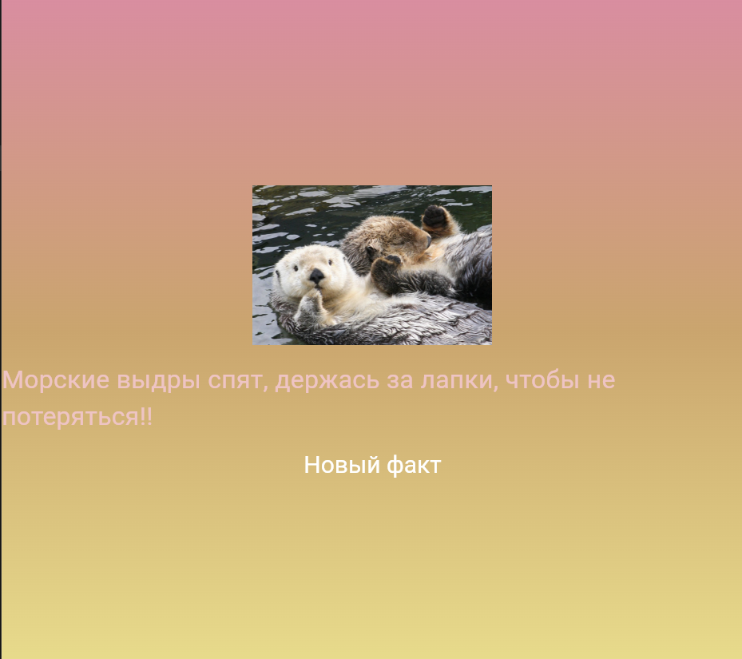

# Карточки с фактами о зверьках

Flutter-приложение: на экране показывается фото животного и факт о нём, а кнопка «Новый факт» показывает другое животное и факт!!

## Автор
Беляева Виктория, группа ИСП-241, дата сдачи: 26.11.2026

## Стек и версии
- Flutter: 3.50.0
- Dart: 3.13.2
- Платформа: Web (Chrome)
- IDE: VS Code

## Скриншот


## Структура проекта
- `lib/main.dart` — точка входа, MaterialApp → Scaffold → GradientContainer
- `lib/gradient_container.dart` — StatelessWidget, градиентный фон, цвета передаются параметрами
- `lib/styled_text.dart` — StatelessWidget, желтый текст размером 32, текст передаётся параметром
- `lib/fact_generator.dart` — StatefulWidget, картинка, факт и кнопка, setState и Random

## Как запустить
```bash
git clone https://github.com/bleb-le/Flutter_Lab5
cd my_app_belyaeva
flutter pub get
flutter run -d chrome
```

## Что изучили
изучила факты о животных!!

## Ответы на вопросы

вопросов нет!
